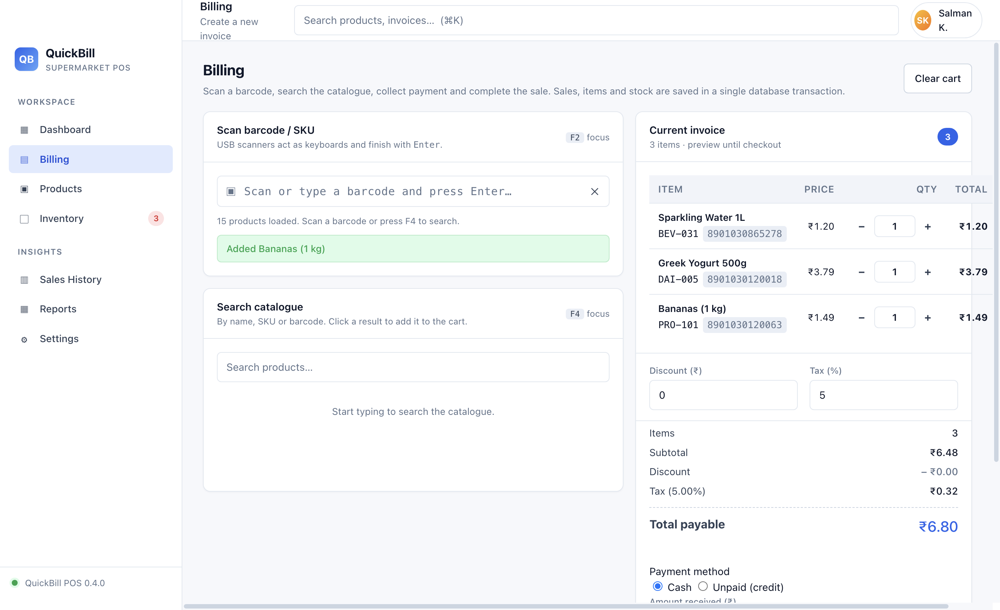
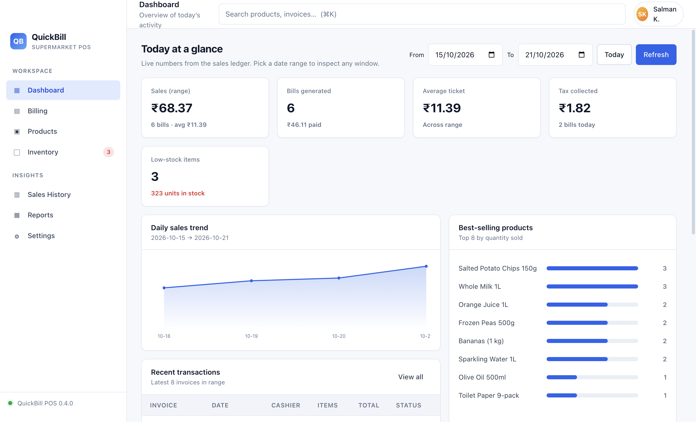
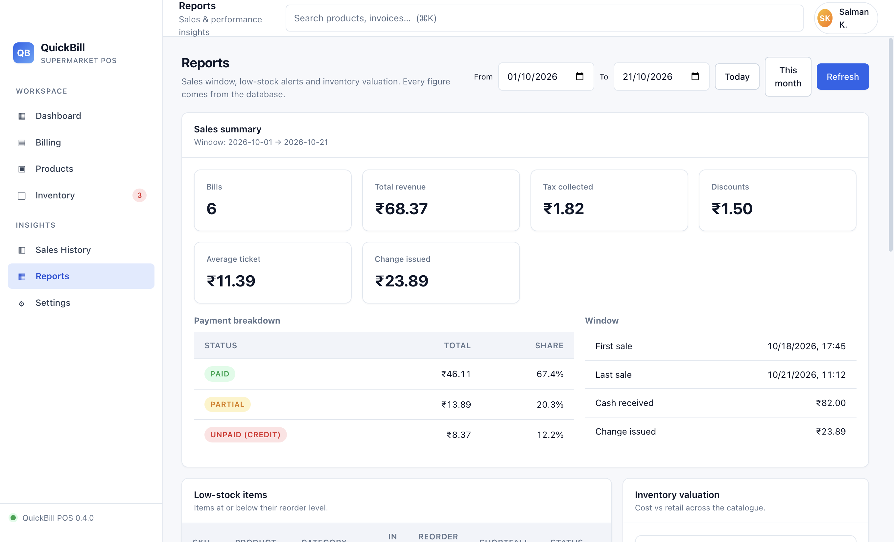
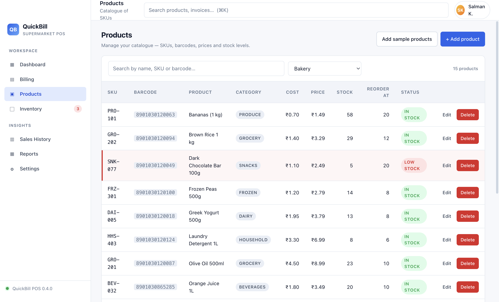
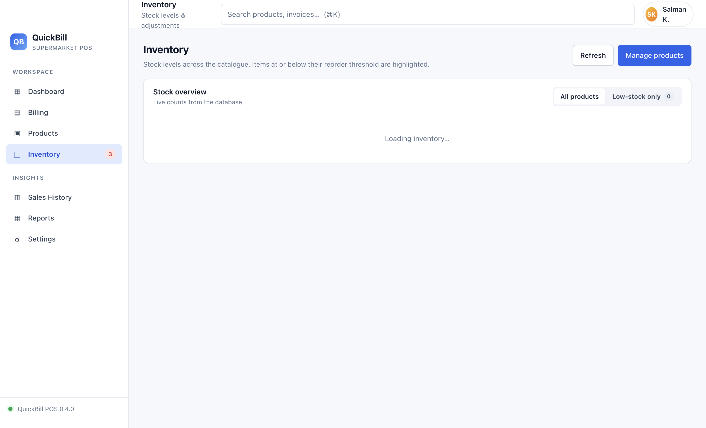
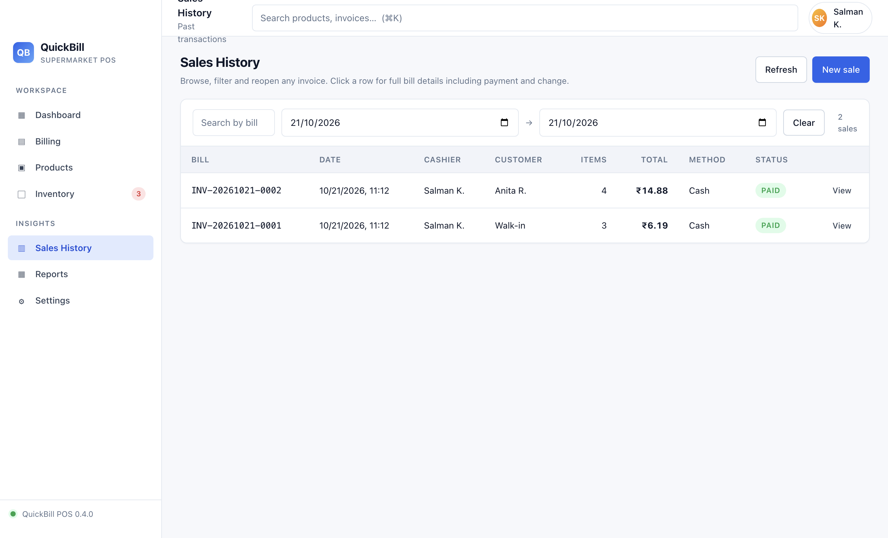
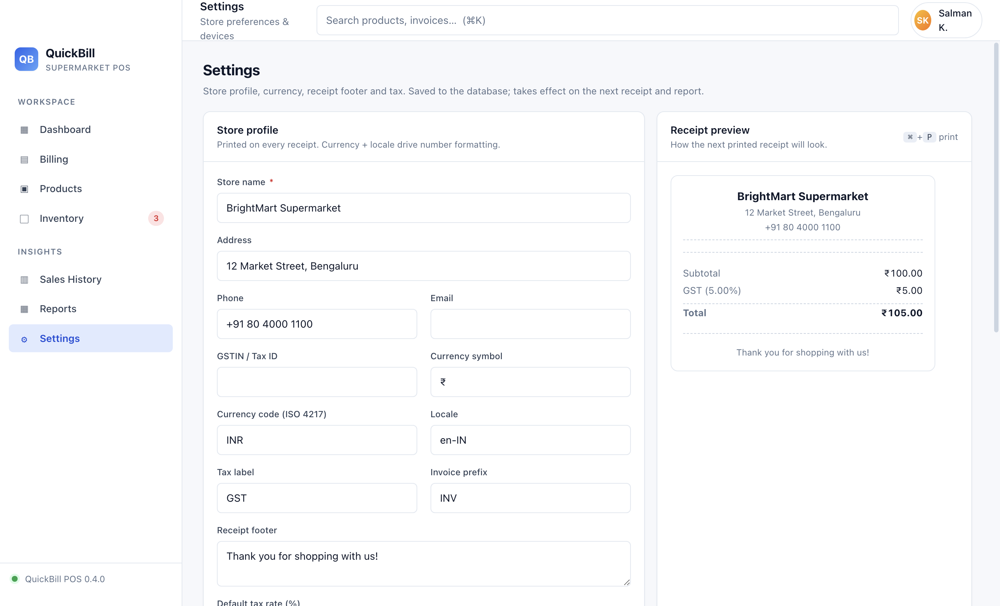

# QuickBill

**A desktop point-of-sale app for supermarkets.** Scan a barcode, ring up the
basket, take the money, print the receipt — with the catalogue, stock, sales
ledger and reports all in one local SQLite file.

No server, no account, no cloud. The whole shop's data is a single
`quickbill.sqlite` you can back up with one click.

<p align="center">
  
</p>

<p align="center">
  
  
</p>
<p align="center">
  
  
</p>
<p align="center">
  
  
</p>

---

## Features

| Area | What it does |
|------|--------------|
| **Billing** | USB barcode-scanner capture, catalogue search, quantity / discount / tax controls, live totals, cash & credit payment, change due |
| **Catalogue** | Full product CRUD with barcode + SKU uniqueness, category filter, live search, idempotent 15-item sample seeder |
| **Inventory** | Stock levels per product, reorder thresholds, low-stock highlighting, sidebar badge with a live count |
| **Sales ledger** | Every checkout written in one SQLite transaction — invoice, line items and stock decrement commit or roll back together |
| **Receipts** | Generated for every sale and re-printable from Sales History, with store profile, bill number, tax breakdown and change due |
| **Dashboard** | Range-scoped sales, bill count, average ticket, tax collected, 14-day trend, best sellers, recent transactions |
| **Reports** | Sales summary, low stock, inventory valuation (cost vs retail), per-category breakdown |
| **Store profile** | Name, address, phone, email, GSTIN, currency code + symbol, locale, tax label + percent, invoice prefix, receipt footer |
| **Backup & restore** | Native file dialogs in Settings — the renderer never names a path |
| **Demo data** | One click books 30 days of realistic backdated invoices so nothing is empty on first run |

## Tech

- **Electron 31** — `contextIsolation: true`, `nodeIntegration: false`, `sandbox: true`.
- **better-sqlite3** — synchronous, single-process, no worker thread. Rebuilt
  against Electron's Node ABI by the `postinstall` hook.
- **Vanilla ES modules** in the renderer. No bundler, no framework, no build
  step. Styling via CSS custom properties in `src/styles/base.css`.
- **Intl.NumberFormat** for currency, with Indian lakh/crore grouping (`₹1,23,456.78`).

## Quick start

```bash
npm install     # the postinstall hook rebuilds better-sqlite3 for Electron
npm start
```

Requires **Node ≥ 22.12** — the floor `@electron/rebuild` enforces, and it runs
in the `postinstall` hook — and macOS. Printing goes through the native
CUPS-backed print dialog; everything else is platform-agnostic.

> `better-sqlite3` is a native module. If you see `NODE_MODULE_VERSION X` in
> the output, re-run the rebuild:
>
> ```bash
> npm run rebuild      # electron-rebuild -f -w better-sqlite3
> ```

Then, on first launch:

1. **Products → Add sample products** — inserts 15 items across 9 categories.
2. **Sales History → Load demo month** — books 30 days of invoices.
3. **Billing** — scan `8901030865278` and press <kbd>Enter</kbd>, then <kbd>F9</kbd> to complete the sale.

## Keyboard shortcuts

Cashiers live on the keyboard, so the hotkeys are function keys that don't
collide with typing.

| Key | Where | Action |
|-----|-------|--------|
| <kbd>F2</kbd> | Billing | Focus the scan input |
| <kbd>F4</kbd> | Billing | Focus catalogue search |
| <kbd>F9</kbd> | Billing | Complete the sale |
| <kbd>Enter</kbd> | Billing | Commit a scanned code; commit a quantity edit |
| <kbd>Esc</kbd> | Billing | Clear the scan input; clear search and return to scanning |
| <kbd>Esc</kbd> | Any modal | Close it |
| <kbd>⌘K</kbd> / <kbd>Ctrl K</kbd> | Anywhere | Jump to global search (products + invoices) |

## Where the data lives

One SQLite file, outside the app bundle, so uninstalling never destroys it:

| Platform | Path |
|----------|------|
| macOS | `~/Library/Application Support/QuickBill/quickbill.sqlite` |
| Linux | `~/.config/QuickBill/quickbill.sqlite` |
| Windows | `%APPDATA%\QuickBill\quickbill.sqlite` |

In development the product name falls back to `Electron`, so the file lands in
`~/Library/Application Support/Electron/`. **Settings** shows the live path, and
offers **Back up now…** / **Restore from a backup…**.

Schema: `products`, `sales`, `sale_items`, `settings`, `idempotency`.

Sales and sale items are append-only — there is no update path, so a completed
invoice can't be silently rewritten. Deleting a product that has been sold is
rejected by a foreign key (`ON DELETE RESTRICT`).

## Money handling

Every amount is an **integer count of paise** (₹1 = 100 paise) from the moment it
enters the cart to the moment SQLite stores it. Percentages use half-to-even
rounding at the boundary: `₹0.10 + ₹0.20` with 5% tax is a 30-paise subtotal, a
2-paise tax and exactly `₹0.32` — never `₹0.30000000000000004`.

Prices are resolved **authoritatively in the main process** at checkout. The
renderer sends the cart shape and the payment intent; a `unit_price_paise` field
in the payload is ignored.

## Tests

```bash
npm test              # all suites — 182 assertions
npm run test:phase4   # checkout, idempotency, bill numbering, tax
npm run test:phase5   # store profile, reports, receipts, historical integrity
npm run test:demo     # demo seeder: realism, idempotency, stock safety
```

```
48 passed, 0 failed     ✓ phase4
69 passed, 0 failed     ✓ phase5
65 passed, 0 failed     ✓ demo
```

The runner re-execs each suite under Electron with `ELECTRON_RUN_AS_NODE=1`,
because the `better-sqlite3` binary is built against Electron's Node ABI and
plain system Node cannot load it.

There is also a headless UI smoke test that boots Electron, mounts every view
through the real SPA controller and IPC handlers, drives the interactive paths
(open a bill → preview → reprint) and asserts on the DOM. It exits non-zero on
any failure and writes screenshots to `tools/.smoke-phase5/`:

```bash
./node_modules/electron/dist/Electron.app/Contents/MacOS/Electron \
  tools/smoke-ui-phase5.js
# 55/55 checks passed
```

## Project structure

```
main.js                Electron main process — window, native dialogs, print
preload.js             contextBridge surface exposed as window.quickbill
src/
  index.html           App shell
  styles/              base.css (design tokens), layout.css, components.css
  main/
    db.js              SQLite layer — schema, prepared statements, validation
    money.js           Currency math shared by the main process
    ipc.js             createIpcHandlers(): channel -> handler registry
  scripts/
    app.js             SPA controller, mounts views, sidebar badge
    views/             One render() per top-level tab
    lib/
      money.js         Currency math (integer paise, no floats)
      cart.js          Cart state, totals breakdown, line items
      format.js        Intl-based currency / locale formatting
      receipt.js       buildReceiptDocuments(): in-app + printable HTML
      print.js         Printer list, print request, error-code mapping
    data/demo-data.js  Static numbers used by the dashboard
tools/                 Test suites + screenshot helpers
docs/DEVELOPMENT.md    Schema, IPC surface, per-phase verification checklists
mockups/               Screenshots used in this README
```

## Security model

The renderer has no Node, no filesystem and no direct database access. Every
read and write crosses `contextBridge` and lands on an `ipcMain` handler.

- Channels return `{ ok: true, data }` or `{ ok: false, error: { code, message, field, errors } }`.
- Validation errors carry a field-keyed `errors` map so forms can mark the offending input.
- SQL is parameterised throughout — never string-concatenated.
- Printing happens entirely in the main process; the renderer sends HTML plus
  a printer name, and the HTML is loaded into a hidden window with the same
  secure defaults.
- The demo seeder's backdating override is a second argument to `createSale()`
  in the main process. Nothing sent over IPC can reach it, so a real checkout
  can never be stamped into the past.

## Printing

Receipts go through the OS print dialog (`webContents.print`), so any printer
macOS knows about works — including the built-in **Save as PDF** for testing
without hardware. Failure modes are explicit rather than silent:

| Code | Meaning |
|------|---------|
| `NO_PRINTER` | No printer configured — the banner points at System Settings → Printers & Scanners |
| `PRINTER_CANCELLED` | The cashier dismissed the dialog (informational, not an error) |
| `PRINTER_FAILED` | The print system reported a failure, with the reason |
| `VALIDATION` | The print request arrived without receipt HTML |

Setup checklist: [`docs/DEVELOPMENT.md`](docs/DEVELOPMENT.md#macos-printer-setup--checklist).

## Status

Built and tested through Phase 5. The demo seeder, reports and print pipeline
are covered by 182 assertions plus a 55-check headless UI smoke.

Not built yet: multi-user accounts and permissions, product purchase-order
management, supplier records, GST filing exports, and a packaged `.app` /
`.dmg` build (`electron-builder` is already a dev dependency).

## License

No license has been granted yet — this is an unlicensed, private project.
Add a `LICENSE` file before treating it as open source.

## Documentation

Full reference — schema DDL, the IPC surface, the print pipeline, money
rounding rules, and a manual verification checklist for every phase — lives in
[`docs/DEVELOPMENT.md`](docs/DEVELOPMENT.md).